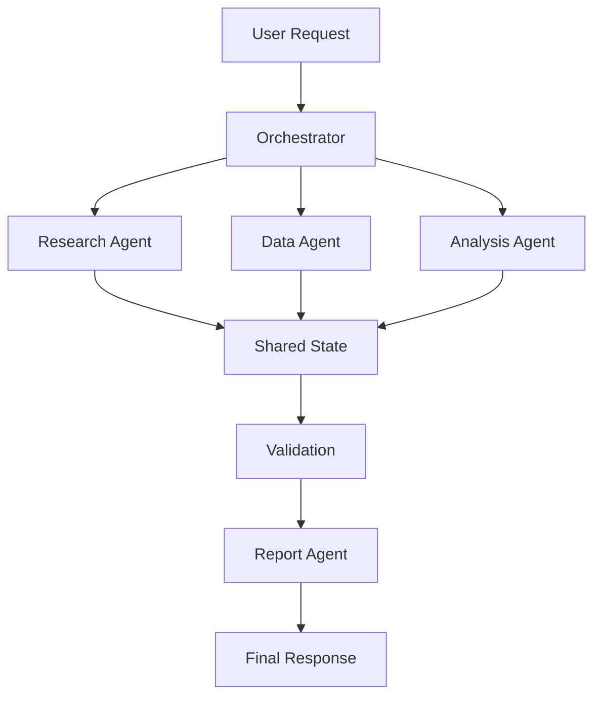

# AI Agent Orchestration Platform

Reference architecture for controlled multi-agent workflows.

## Example
A business investigation request is decomposed into research, data, analysis and reporting tasks.



## Design Principles
- Explicit agent responsibilities
- Tool allow-lists
- Shared state schema
- Validation before final output
- Human escalation for ambiguous/high-risk tasks
- Traceability of agent actions

## Run
```bash
pip install -r requirements.txt
python examples/demo.py
```
